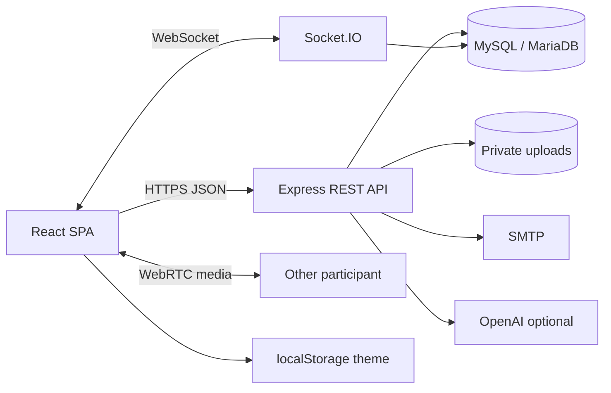

# Software Requirements Specification (SRS)

## TechNexa Solutions - IT Services and Learning Platform

| Item | Detail |
|---|---|
| Project | TechNexa Solutions Platform |
| Document | Software Requirements Specification |
| Version | 1.0 |
| Date | 03 November 2026 |
| Stack | React 18 + Node.js 20 + Express 4 + MySQL / MariaDB |
| Prepared for | Final Year Project review and viva |
| Repository | `mern/` |

---

## 1. Introduction

### 1.1 Purpose

This Software Requirements Specification defines the functional and non-functional requirements of the TechNexa Solutions platform. The document is intended for the project supervisor, examination committee, developers, testers and future maintainers.

It explains what the system must do, who uses it, how the modules interact, what data is stored and which quality attributes the implementation must satisfy.

### 1.2 Scope

TechNexa is a web-based platform that combines:

1. A public IT-services and training website.
2. A course catalogue and enrollment flow.
3. A role-based learning portal for students, teachers and administrators.
4. Academic features such as assignments, quizzes, attendance, marks, timetable, materials, fees and documents.
5. Real-time private chat, presence, audio/video calls and optional call recording.
6. Administrative reporting, audit logs, payment tracking and communication tools.
7. Light and dark themes across the public site and portal.

The system does **not** include a payment-gateway integration, a native mobile application, a full video-conferencing recorder or an external LMS migration tool. These are listed as future work.

### 1.3 Definitions and Abbreviations

| Term | Meaning |
|---|---|
| SRS | Software Requirements Specification |
| SPA | Single Page Application |
| JWT | JSON Web Token |
| API | Application Programming Interface |
| CRUD | Create, Read, Update, Delete |
| RBAC | Role-Based Access Control |
| WebRTC | Web Real-Time Communication |
| MCQ | Multiple-Choice Question |
| UTC | Coordinated Universal Time |
| AI | Artificial Intelligence |
| LMS | Learning Management System |

### 1.4 References

- `mern/docs/ARCHITECTURE.md`
- `mern/docs/API.md`
- `mern/docs/DATABASE.md`
- `mern/docs/DEPLOYMENT.md`
- `mern/docs/ONE-PAGE-SUMMARY.md`
- `mern/README.md`
- IEEE 830-style SRS structure (adapted)

---

## 2. Overall Description

### 2.1 Product Perspective

TechNexa is a standalone, browser-based system built as a feature-based monorepo. The React client communicates with an Express REST API. MySQL stores relational data. Socket.IO handles real-time events, and WebRTC handles peer-to-peer audio/video calls.

The platform replaces a collection of disconnected static pages and manual academic records with one authenticated system. Public visitors can browse services and courses; registered users enter a portal whose navigation and API permissions depend on their role.

### 2.2 Product Functions

The major functions are:

- Public website with service, course, industry and legal information.
- Student and teacher registration with administrator approval.
- Secure login, logout, password reset and session handling.
- Course catalogue and enrollment management.
- Student dashboard, fees, documents, assignments, marks, attendance and timetable.
- Teacher dashboard, course rosters, grading, attendance, materials, announcements and question bank.
- Quiz creation, publishing, attempting, automatic scoring and result review.
- AI-assisted question generation with a built-in fallback when no external AI key is configured.
- Private chat with presence, attachments, edit, delete and voice-note support.
- Audio/video calling with call logs and optional mixed-audio recording.
- Admin management of users, teachers, enrollments, courses, payments, logs, subscribers and contact messages.
- Light/dark theme with persistent user preference.
- Deployment scripts for local, Docker and Nginx-based environments.

### 2.3 User Classes and Characteristics

| User class | Description | Main needs |
|---|---|---|
| Visitor | Unauthenticated user browsing the public website | Service information, courses, contact form, newsletter |
| Student | Registered learner with an approved or pending enrollment | Course access, assignments, quizzes, marks, fees, materials, chat, calls |
| Teacher | Approved instructor assigned to courses | Student lists, grading, attendance, timetable, materials, quizzes, question bank, chat, calls |
| Administrator | Platform owner or academic administrator | User approval, enrollment and payment control, course management, audit logs, call logs, reports |
| System | Scheduled jobs, database and Socket.IO services | Data integrity, real-time delivery, cleanup, email and backups |

### 2.4 Operating Environment

- **Client:** modern Chromium, Firefox or Safari browser with JavaScript and WebRTC support.
- **Server:** Node.js 20 or later on Windows, Linux or a container platform.
- **Database:** MySQL 8 or MariaDB 10.4 or later.
- **Network:** HTTPS is required in production for secure cookies and WebRTC microphone/camera access.
- **Storage:** local filesystem for uploaded documents, avatars, chat attachments and call recordings; object storage can replace it later.

### 2.5 Design and Implementation Constraints

1. The database is relational (MySQL/MariaDB), so the accurate stack name is **React + Node.js + Express + MySQL**, not MERN.
2. Authentication uses a JWT stored in an **httpOnly cookie**; tokens must not be exposed to JavaScript.
3. All protected API routes must verify authentication and role.
4. Uploaded files must not be publicly listable; access must pass through authenticated routes.
5. All timestamps are stored and compared in UTC.
6. The UI must remain usable on desktop, tablet and mobile widths.
7. The application must not depend on a paid external service for core academic features.
8. AI quiz generation is optional; the system must still generate questions when `OPENAI_API_KEY` is absent.

### 2.6 Assumptions and Dependencies

- The institute has a MySQL/MariaDB server and a Node.js runtime.
- Email delivery for password reset requires valid SMTP settings; the reset link is still generated in the database.
- WebRTC calls use a STUN server; a TURN server is recommended for restrictive networks.
- The browser grants microphone/camera permissions for calls and recording.
- Demo data is seeded for evaluation; production data must be backed up separately.
- OpenAI is optional and is not required for the built-in quiz generator.

---

## 3. System Features

Priority scale: **M** = mandatory, **S** = should have, **C** = could have.

### 3.1 Public Website and Course Catalogue

| ID | Requirement | Priority |
|---|---|---|
| FR-PUB-01 | The system shall display a branded public home page with services, training programmes, statistics and calls to action. | M |
| FR-PUB-02 | The system shall provide About, Courses, Industries and Legal pages. | M |
| FR-PUB-03 | The system shall display service detail pages from a data-driven route. | M |
| FR-PUB-04 | The system shall list active courses with category, tag, description, duration/meta and price. | M |
| FR-PUB-05 | The system shall allow a visitor to search or filter the course catalogue. | S |
| FR-PUB-06 | The system shall provide a contact form that stores the message for administrators. | M |
| FR-PUB-07 | The system shall allow visitors to subscribe to updates with an email address. | S |
| FR-PUB-08 | The system shall require an authenticated student account before accepting a course enrollment, and shall not accept document uploads from guests. | M |
| FR-PUB-09 | The public site shall show a readable navigation bar and Login button in both light and dark themes. | M |
| FR-PUB-10 | The public site shall provide a responsive mobile navigation drawer. | M |

### 3.2 Authentication and Account Management

| ID | Requirement | Priority |
|---|---|---|
| FR-AUTH-01 | The system shall allow students and teachers to register with validated personal and contact details. | M |
| FR-AUTH-02 | The system shall reject duplicate email addresses and weak passwords. | M |
| FR-AUTH-03 | The system shall hash passwords with bcrypt before storage. | M |
| FR-AUTH-04 | The system shall authenticate users with email and password and issue an httpOnly JWT cookie. | M |
| FR-AUTH-05 | The system shall support logout by clearing the authentication cookie. | M |
| FR-AUTH-06 | The system shall redirect unauthenticated users away from protected portal routes. | M |
| FR-AUTH-07 | The system shall enforce role-based access for student, teacher and admin pages and APIs. | M |
| FR-AUTH-08 | The system shall support forgot-password requests and one-hour reset tokens. | M |
| FR-AUTH-09 | The system shall record successful and failed login attempts for auditing. | S |
| FR-AUTH-10 | The system shall allow teachers to remain pending until an administrator approves the account. | M |

### 3.3 Student Portal

| ID | Requirement | Priority |
|---|---|---|
| FR-STU-01 | The student dashboard shall summarise enrollments, pending assignments, available quizzes, attendance and outstanding fees. | M |
| FR-STU-02 | The student shall view available courses and submit enrollment requests. | M |
| FR-STU-03 | The student shall view enrollment status and payment progress. | M |
| FR-STU-04 | The student shall view, submit and track assignments. | M |
| FR-STU-05 | The student shall attempt published quizzes and view results. | M |
| FR-STU-06 | The student shall view marks, grades and result summaries. | M |
| FR-STU-07 | The student shall view attendance history and percentage. | M |
| FR-STU-08 | The student shall view the weekly timetable. | M |
| FR-STU-09 | The student shall download course materials shared by teachers. | M |
| FR-STU-10 | The student shall view fees, payments and outstanding balance. | M |
| FR-STU-11 | The student shall view and download personal documents. | M |
| FR-STU-12 | The student shall view notices and announcements targeted to students. | M |
| FR-STU-13 | The student shall update profile details and avatar. | S |
| FR-STU-14 | The student shall chat privately with teachers and join audio/video calls. | M |

### 3.4 Teacher Portal

| ID | Requirement | Priority |
|---|---|---|
| FR-TEA-01 | The teacher dashboard shall summarise assigned courses, students, pending submissions, quizzes, upcoming classes and recent activity. | M |
| FR-TEA-02 | The teacher shall view assigned courses and student rosters. | M |
| FR-TEA-03 | The teacher shall create assignments and grade student submissions. | M |
| FR-TEA-04 | The teacher shall create, edit, publish and close quizzes. | M |
| FR-TEA-05 | The teacher shall add questions manually or generate them through the AI question generator. | M |
| FR-TEA-06 | The teacher shall save generated questions to the reusable question bank. | M |
| FR-TEA-07 | The teacher shall create attendance sessions and mark students present, absent or late. | M |
| FR-TEA-08 | The teacher shall manage the course timetable. | M |
| FR-TEA-09 | The teacher shall upload course materials. | M |
| FR-TEA-10 | The teacher shall publish announcements to assigned courses. | M |
| FR-TEA-11 | The teacher shall view student profiles relevant to assigned courses. | S |
| FR-TEA-12 | The teacher shall chat privately with students and join audio/video calls. | M |

### 3.5 Administrator Portal

| ID | Requirement | Priority |
|---|---|---|
| FR-ADM-01 | The admin dashboard shall show totals for students, teachers, enrollments, revenue, pending teachers and failed logins. | M |
| FR-ADM-02 | The admin shall list, search and manage students. | M |
| FR-ADM-03 | The admin shall approve, reject or suspend teachers. | M |
| FR-ADM-04 | The admin shall manage enrollments and their status. | M |
| FR-ADM-05 | The admin shall record and review payments. | M |
| FR-ADM-06 | The admin shall create, update and deactivate courses. | M |
| FR-ADM-07 | The admin shall view all assignments, quizzes and academic records. | S |
| FR-ADM-08 | The admin shall view login/audit logs. | M |
| FR-ADM-09 | The admin shall view call logs and play authorised call recordings. | M |
| FR-ADM-10 | The admin shall manage password-reset links. | S |
| FR-ADM-11 | The admin shall review contact messages and newsletter subscribers. | M |
| FR-ADM-12 | The admin shall access reports and exportable operational data where implemented. | C |

### 3.6 Quizzes and Question Bank

| ID | Requirement | Priority |
|---|---|---|
| FR-QUIZ-01 | The system shall store reusable questions with four options, a correct answer and marks. | M |
| FR-QUIZ-02 | The teacher shall create a quiz with title, course/audience, duration, status and questions. | M |
| FR-QUIZ-03 | The system shall support general quizzes and course-specific quizzes. | M |
| FR-QUIZ-04 | The system shall publish a quiz only when it has valid questions. | M |
| FR-QUIZ-05 | The student shall start or resume a published quiz attempt. | M |
| FR-QUIZ-06 | The system shall prevent duplicate attempts where a single attempt is required. | M |
| FR-QUIZ-07 | The system shall score submitted answers automatically and store the result. | M |
| FR-QUIZ-08 | The student shall see score, total marks, percentage and answer review. | M |
| FR-QUIZ-09 | The teacher shall see attempts and scores for owned quizzes. | M |
| FR-QUIZ-10 | The AI generator shall return valid MCQ objects for a topic and count. | M |
| FR-QUIZ-11 | If no OpenAI key is configured or the AI request fails, the system shall fall back to a built-in question generator instead of showing an error. | M |
| FR-QUIZ-12 | The system shall validate AI output, normalise option keys and correct-answer letters, and fill missing options safely. | M |
| FR-QUIZ-13 | The teacher shall be able to save generated questions to the question bank. | M |
| FR-QUIZ-14 | The student shall see every question, the answered count and a progress bar before submitting. | M |
| FR-QUIZ-15 | The system shall block manual submission until every question has been answered. | M |
| FR-QUIZ-16 | If the timer expires, the system shall submit the attempt automatically; an attempt left incomplete may be retaken. | M |
| FR-QUIZ-17 | The system shall record a violation when a student leaves the quiz screen, switches tabs/apps, turns off the screen, loses window focus, exits fullscreen or copies quiz content. | M |
| FR-QUIZ-18 | The admin shall see the quiz violation log and the total violation count on the admin dashboard. | M |

### 3.7 Chat and Presence

| ID | Requirement | Priority |
|---|---|---|
| FR-CHAT-01 | Authenticated users shall see a list of permitted contacts. | M |
| FR-CHAT-02 | Users shall exchange private text messages in real time. | M |
| FR-CHAT-03 | Users shall see online/offline presence. | S |
| FR-CHAT-04 | Users shall attach images, documents and audio files. | M |
| FR-CHAT-05 | Users shall edit or delete their own messages. | S |
| FR-CHAT-06 | Users shall see unread-message indicators. | S |
| FR-CHAT-07 | Chat attachments shall be served only through authenticated routes. | M |
| FR-CHAT-08 | Users shall start an audio or video call from a conversation. | M |

### 3.8 Audio/Video Calls and Recording

| ID | Requirement | Priority |
|---|---|---|
| FR-CALL-01 | Users shall start an audio or video call to an online permitted contact. | M |
| FR-CALL-02 | The callee shall receive an incoming-call prompt and accept or reject it. | M |
| FR-CALL-03 | The system shall exchange WebRTC offer, answer and ICE candidates through Socket.IO. | M |
| FR-CALL-04 | Both parties shall mute/unmute audio, enable/disable video and end the call. | M |
| FR-CALL-05 | The system shall write a call log with caller, callee, type, status, start and end time. | M |
| FR-CALL-06 | The caller may start and stop recording during a call. | S |
| FR-CALL-07 | Recording shall mix the local microphone and remote audio so both voices are captured. | S |
| FR-CALL-08 | Both participants shall see a visible Recording indicator while recording is active. | M |
| FR-CALL-09 | The recording shall upload to private server storage and be linked to the call log. | S |
| FR-CALL-10 | Only call participants and administrators shall access a recording. | M |
| FR-CALL-11 | The admin call-log page shall provide authenticated playback. | S |

### 3.9 Notices, Announcements and Notifications

| ID | Requirement | Priority |
|---|---|---|
| FR-NOT-01 | Administrators and authorised staff shall create notices for selected audiences. | M |
| FR-NOT-02 | Teachers shall create announcements for assigned courses. | M |
| FR-NOT-03 | Students shall see notices and announcements relevant to their role/course. | M |
| FR-NOT-04 | The dashboard shall surface recent notices and announcements. | S |
| FR-NOT-05 | Email notification shall be used for password reset and may be extended to notices. | S |

### 3.10 Theme, Accessibility and Responsiveness

| ID | Requirement | Priority |
|---|---|---|
| FR-UI-01 | The public site and portal shall provide light and dark themes. | M |
| FR-UI-02 | The selected theme shall persist in `localStorage` under `technexa_theme`. | M |
| FR-UI-03 | The system shall respect the operating-system theme on first visit. | S |
| FR-UI-04 | The theme toggle shall be available on public, auth and portal layouts. | M |
| FR-UI-05 | Text and controls shall meet readable contrast in both themes. | M |
| FR-UI-06 | Course cards shall have consistent heights and bottom-aligned actions. | S |
| FR-UI-07 | Layouts shall adapt to desktop, tablet and mobile widths. | M |
| FR-UI-08 | Icons shall use Font Awesome; no decorative arrows, chevrons, carets or rocket icons. | S |

### 3.11 Deployment and Operations

| ID | Requirement | Priority |
|---|---|---|
| FR-OPS-01 | The project shall provide a one-command local development launcher. | S |
| FR-OPS-02 | The database schema shall be created and upgraded through numbered migrations. | M |
| FR-OPS-03 | Demo accounts and realistic sample data shall be seedable. | M |
| FR-OPS-04 | The system shall expose a health endpoint. | M |
| FR-OPS-05 | The project shall include Docker, Nginx and CI configuration. | S |
| FR-OPS-06 | Runtime uploads and secrets shall be excluded from version control. | M |

---

## 4. External Interface Requirements

### 4.1 User Interfaces

- Responsive public website with white/dark navbar, hero, service cards, course grid, contact form and footer.
- Authentication pages with login, registration chooser, student registration, teacher registration, forgot password and reset password.
- Portal layout with role-aware sidebar, top bar, theme toggle, profile menu and sign-out.
- Data tables, modals, forms, badges, empty states and confirmation dialogs.
- Chat window with message list, composer, attachment control and call controls.
- Call overlay with incoming/outgoing states, mute, video and end-call actions.
- Admin call-log page with audio player for recordings.

### 4.2 Hardware Interfaces

- Standard keyboard, mouse/touch input, microphone, speakers and optional camera.
- Server disk for uploads and recordings.
- Network interface for HTTP/HTTPS, WebSocket and WebRTC traffic.

### 4.3 Software Interfaces

| Interface | Purpose |
|---|---|
| MySQL/MariaDB | Persistent relational data |
| Express REST API | Client-server communication |
| Socket.IO | Chat, presence and call signalling |
| WebRTC + STUN/TURN | Peer-to-peer audio/video |
| Nodemailer/SMTP | Password-reset email |
| OpenAI Chat Completions API | Optional AI question generation |
| Browser localStorage | Theme preference |
| Browser MediaRecorder/Web Audio | Call recording and mixed audio |

### 4.4 Communication Protocols

- HTTPS for production web traffic.
- JSON over HTTP for REST requests.
- WebSocket for real-time events.
- WebRTC for media streams.
- SMTP for email delivery.
- HTTPS to the OpenAI API when configured.

---

## 5. Non-Functional Requirements

### 5.1 Security

| ID | Requirement |
|---|---|
| NFR-SEC-01 | Passwords shall be hashed with bcrypt and never returned by the API. |
| NFR-SEC-02 | Authentication tokens shall be stored in httpOnly, SameSite cookies. |
| NFR-SEC-03 | All SQL queries shall use parameterised statements. |
| NFR-SEC-04 | Every protected route shall verify authentication and role. |
| NFR-SEC-05 | Uploaded files shall be validated by type and size and served through authenticated routes. |
| NFR-SEC-06 | Call recordings shall be private to participants and administrators. |
| NFR-SEC-07 | Password-reset tokens shall expire after one hour and be single-use. |
| NFR-SEC-08 | Login attempts shall be rate-limited and audited. |
| NFR-SEC-09 | Secrets shall be stored in environment variables, not source code. |
| NFR-SEC-10 | Production deployments shall use HTTPS. |

### 5.2 Performance

| ID | Requirement |
|---|---|
| NFR-PERF-01 | Standard API reads should respond within 500 ms on a local demo dataset. |
| NFR-PERF-02 | The initial client bundle should load within a reasonable time on a broadband connection. |
| NFR-PERF-03 | Dashboard queries should use indexed keys and bounded result sets. |
| NFR-PERF-04 | Real-time chat messages should be delivered without a page refresh. |
| NFR-PERF-05 | Uploaded files should be size-limited to protect server resources. |

### 5.3 Reliability and Availability

| ID | Requirement |
|---|---|
| NFR-REL-01 | Database operations shall use a connection pool and handle connection errors. |
| NFR-REL-02 | The API shall return consistent JSON error responses. |
| NFR-REL-03 | AI failure shall not block manual quiz creation or the built-in generator. |
| NFR-REL-04 | Uploaded files shall be removed when a related database operation fails where practical. |
| NFR-REL-05 | The system shall recover cleanly after a server restart. |

### 5.4 Usability

| ID | Requirement |
|---|---|
| NFR-USE-01 | A new user should be able to log in and reach the correct dashboard without training. |
| NFR-USE-02 | Forms shall show clear validation and error messages. |
| NFR-USE-03 | Empty states shall explain what to do next. |
| NFR-USE-04 | Destructive actions shall ask for confirmation. |
| NFR-USE-05 | The interface shall remain readable in both themes. |

### 5.5 Maintainability

| ID | Requirement |
|---|---|
| NFR-MAIN-01 | Code shall follow a feature-based folder structure. |
| NFR-MAIN-02 | API, database and deployment behaviour shall be documented in `docs/`. |
| NFR-MAIN-03 | Shared UI and API helpers shall be reused instead of duplicated. |
| NFR-MAIN-04 | Database changes shall be delivered as numbered migrations. |
| NFR-MAIN-05 | The client shall build successfully with `npm run build`. |

### 5.6 Portability

| ID | Requirement |
|---|---|
| NFR-PORT-01 | The server shall run on Windows, Linux and Docker. |
| NFR-PORT-02 | The client shall run in modern evergreen browsers. |
| NFR-PORT-03 | Configuration shall be environment-driven. |

### 5.7 Privacy and Compliance

| ID | Requirement |
|---|---|
| NFR-PRIV-01 | Students shall access only their own records and files. |
| NFR-PRIV-02 | Teachers shall access only assigned courses and related students. |
| NFR-PRIV-03 | Chat shall be private between participants. |
| NFR-PRIV-04 | Call recordings shall not be publicly accessible. |
| NFR-PRIV-05 | Personal data should be collected only for academic and operational purposes. |

---

## 6. Data Requirements

### 6.1 Main Entities

| Entity | Key fields |
|---|---|
| User | id, full_name, email, phone, password_hash, role, status, photo, last_login |
| Student profile | user_id, guardian, address, education, date_of_birth |
| Teacher profile | user_id, expertise, qualification, experience, portfolio, expected_fee, availability |
| Course | id, title, category, tag, short_desc, description, meta, price, featured, active |
| Enrollment | id, user_id, course_title, status, fee_total, applied_at |
| Payment | id, enrollment_id, amount, method, reference, paid_at |
| Assignment | id, course_title, title, description, due_at, marks, created_by |
| Submission | id, assignment_id, student_id, file_id, text, grade, feedback, submitted_at |
| Quiz | id, title, course_title, audience, duration, status, created_by |
| Quiz question | id, quiz_id, question, options, correct, marks |
| Question bank | id, teacher_id, course_title, question, options, correct, marks |
| Quiz attempt | id, quiz_id, student_id, score, total, status, started_at, submitted_at |
| Quiz violation | id, quiz_id, attempt_id, student_id, violation_type, details, ip, user_agent, occurred_at |
| Attendance session | id, course_title, date, topic, created_by |
| Attendance record | session_id, student_id, status |
| Timetable | id, course_title, weekday, start_time, end_time, room, teacher_id |
| Material | id, course_title, title, file_id, uploaded_by |
| Document | id, owner_id, kind, title, file_path, created_at |
| Notice | id, title, body, audience, created_by |
| Announcement | id, course_title, title, body, created_by |
| Chat message | id, sender_id, recipient_id, body, edited_at, deleted_at, created_at |
| Chat attachment | id, message_id, file_path, mime, size |
| Call log | id, call_key, caller_id, callee_id, type, status, started_at, ended_at, recording_file |
| Login log | id, user_id, email, role, status, ip, user_agent, created_at |
| Password reset | id, token, user_id, requested_at, expires_at, used |
| Contact message | id, name, email, phone, subject, message, created_at |
| Subscriber | id, email, created_at |

### 6.2 Data Retention

- Academic records are retained for the life of the account unless removed by an administrator.
- Login and call logs are retained for auditing; old records may be purged by a maintenance job.
- Password-reset tokens expire after one hour.
- Uploaded files are retained until the related record is deleted or an administrator removes them.
- Call recordings are retained with the call log unless deleted by an administrator.

### 6.3 Data Validation

- Email addresses must be syntactically valid and unique.
- Passwords must be at least eight characters and contain a letter and a number.
- Phone numbers must match the supported Pakistani format when supplied.
- Course titles, question text, marks and dates must be validated on the server.
- Uploaded files must match allowed extensions and size limits.
- Quiz answers must map to valid option letters.

---

## 7. System Architecture



### 7.1 Layer Responsibilities

| Layer | Responsibility |
|---|---|
| Presentation | React pages, forms, tables, modals, theme and responsive layout |
| Client state | Auth context, fetch hooks, local form state, socket/call hooks |
| API | Routing, validation, authentication, role checks, JSON responses |
| Business logic | Enrollment, grading, quiz scoring, AI fallback, call recording metadata |
| Data access | Parameterised SQL through `mysql2` pool |
| Realtime | Socket.IO chat, presence and WebRTC signalling |
| Storage | MySQL tables and private upload directories |

### 7.2 Deployment View

```text
Browser
  |
  | HTTPS
  v
Nginx / Vite dev server
  |-- static React build
  |-- /api  -> Node.js + Express
  |-- /socket.io -> Socket.IO
  v
MySQL / MariaDB
  |
  +-- uploads/avatars
  +-- uploads/documents
  +-- uploads/chat
  +-- uploads/calls
```

---

## 8. Acceptance Criteria and Traceability

| Area | Acceptance criterion |
|---|---|
| Public site | A visitor can open home, courses, about, industries and legal pages; the navbar and Login button are readable in light and dark themes. |
| Auth | A seeded student, teacher and admin can log in and reach the correct dashboard; protected routes reject guests. |
| Student | The student can see enrollments, assignments, quizzes, marks, attendance, timetable, materials, fees, documents, notices and messages. |
| Teacher | The teacher can see assigned courses/students, create assignments and quizzes, generate questions, mark attendance and publish announcements. |
| Admin | The admin can view totals, manage users/enrollments/courses, view logs and play call recordings. |
| Quiz | A teacher can generate MCQs even without an OpenAI key; the generated questions can be saved and used in a quiz. |
| Chat | Two signed-in users can exchange private messages in real time and upload an attachment. |
| Calls | Two users can start an audio/video call; both see the recording indicator when recording is active; the admin can see the call log. |
| Theme | The theme toggle works on public, auth and portal pages and persists after refresh. |
| Build | `npm run build` completes successfully. |
| Security | Guest and wrong-role requests to protected APIs return 401/403 and never expose private files. |

---

## 9. Appendices

### 9.1 Demo Accounts

| Role | Email | Password |
|---|---|---|
| Admin | `admin@technexa.pk` | `Admin@12345` |
| Teacher | `teacher@technexa.pk` | `Teacher@12345` |
| Student | `student@technexa.pk` | `Student@12345` |
| Student | `ayesha@technexa.pk` | `Student@12345` |
| Pending teacher | `pending.teacher@technexa.pk` | `Teacher@12345` |

### 9.2 Related Documents

- `FYP_REPORT.md` - full final-year project report with screenshots.
- `API.md` - endpoint reference.
- `DATABASE.md` - schema and table notes.
- `DEPLOYMENT.md` - local and production deployment.
- `ARCHITECTURE.md` - design decisions and request flow.
